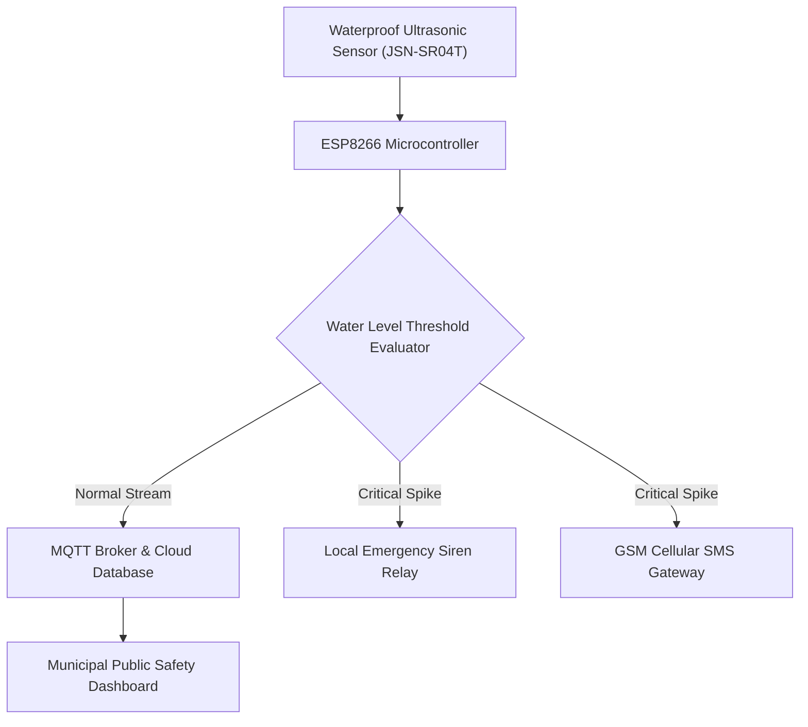

# Floodguard — IoT River Water Level Monitoring & Early Flood Warning System

[](https://www.arduino.cc/)
[](https://mqtt.org/)
[](https://react.dev/)
[](LICENSE.md)

**Floodguard** is an IoT early warning flood detection platform designed for rivers, storm canals, and low-lying urban flood zones. Combining waterproof ultrasonic level sensors, an ESP8266 microcontroller, and a cloud telemetry dashboard, it provides real-time water elevation tracking and dispatches automated alerts before water surpasses critical embankment thresholds.

---

## Problem Statement & Context
Flash flooding claims thousands of lives and causes billions in property damage annually:
- **Delayed Warning Systems**: Downstream communities often receive flood warnings only when water has already breached river embankments.
- **Manual Gauge Inspection**: Municipal authorities still rely on physical staff inspecting painted bridge markers during severe storms.
- **Absence of Hyperlocal Telemetry**: Regional meteorological reports fail to provide neighborhood-level drainage canal status.

---

## Existing Solutions & Critical Gaps
| Detection Method | Measurement Frequency | Warning Speed | Hardware Cost |
| :--- | :--- | :--- | :--- |
| **Manual Gauge Sticks** | 2–4 times per day | Hours of delay | High labor cost |
| **Satellite Radar** | Every 1–3 days | Delayed data processing | Multimillion-dollar infrastructure |
| **Floodguard IoT System** | **Continuous (Every 10 seconds)** | **Instantaneous (<5s alert dispatch)** | **Low-cost (<$30 per sensor node)** |

---

## Proposed Solution & Architectural Innovation
Floodguard establishes an **Automated Hydrological Safety Network**:
- **Non-Contact Water Level Sensing**: Uses high-precision ultrasonic sensors mounted under bridge arches to continuously gauge surface distance without water contact corrosion.
- **Multi-Tier Threat Thresholds**: Evaluates water levels across three standardized tiers: Normal (Green), Advisory (Yellow), and Evacuation Imminent (Red).
- **Automated Siren & SMS Broadcast**: Automatically triggers roadside physical sirens and cellular SMS broadcasts when Red thresholds are sustained for >60 seconds.
- **Live Hydrological Dashboard**: Displays real-time water level graphs, rate of rise (cm/min), and predictive flood arrival times.

---

## Technical Approach & System Architecture


---

## Quantifiable Impact & Measurable Benefits
- **15–45 Minutes Earlier Evacuation Warning**: Provides crucial early warning windows that save lives and movable property.
- **Zero Sensor Corrosion**: Non-contact ultrasonic measurement guarantees years of maintenance-free operation.
- **Sub-$30 Unit Cost**: Enables municipal governments to deploy sensor nodes across every canal bridge.

---

## Feasibility, Operational Viability & Scalability
- **Power Autonomy**: Can be equipped with a compact 5W solar panel and 18650 Li-ion battery for indefinite autonomous operation.

---

## Project Architecture & Quickstart
```bash
git clone https://github.com/Tharun4743/Floodguard.git
cd Floodguard
# Flash firmware via Arduino IDE to ESP8266
# Launch dashboard:
cd web-dashboard && npm install && npm run dev
```

---

## Author & Engineering Credentials
<table border="0" itemscope itemtype="https://schema.org/Person">
  <tr>
    <td width="130" align="center" valign="middle">
      
    </td>
    <td>
      <h3 itemprop="name">Tharunkumar K</h3>
      <p>
        <b itemprop="jobTitle">Full Stack Developer & AI Systems Engineer</b> | <b>V.S.B. Engineering College (VSBEC)</b><br/>
        🎓 <b>B.Tech in Information Technology</b> — <b>V.S.B. Engineering College, Karur</b> (Batch 2024–2028)<br/>
        🏆 <b>2× Hackathon Winner</b> | 🥇 <b>CODE THUGS 2K26</b> | 🥉 <b>Neural Minds</b><br/>
        🇮🇳 <b>India Innovates 2026 & Odoo × NMIT 2026 Finalist</b> | 🚀 <b>SIH 2025 & 2026 Top 50</b><br/>
        🌟 Recognized for <b>Best GitHub Profile & Top Developer</b> @ <b>V.S.B. ENGINEERING COLLEGE</b>
      </p>
      <p>
        🚀 <b>Top Flagship Engineering Projects:</b><br/>
        • 🏛️ <b>TaskManager (VSBEC IT Vault)</b> — Institutional Task Governance & LeetCode/GitHub Sync &nbsp;<a href="https://github.com/Tharun4743/Taskmanager"></a>&nbsp;<a href="https://it-taskmanager.vercel.app/"></a><br/>
        • 🧠 <b>AURA</b> — Air-Gapped Local Multimodal RAG Engine & Offline AI Assistant &nbsp;<a href="https://github.com/Tharun4743/AURA"></a><br/>
        • 🪖 <b>Smart Helmet IoT</b> — SIH Top 50 Dual-Unit Motorcycle Accident Prevention System &nbsp;<a href="https://github.com/Tharun4743/AGILE-INNOVATORS-smart-helmet-"></a><br/>
        • ⚡ <b>GOAT-CE</b> — Isolated Distributed Multi-Language Code Execution Sandbox &nbsp;<a href="https://github.com/Tharun4743/GOAT-CE"></a>
      </p>
      <p>
        <a href="https://tharunkumark4743.netlify.app/"></a>&nbsp;
        <a href="https://github.com/Tharun4743"></a>&nbsp;
        <a href="https://www.linkedin.com/in/tharunkumark4743"></a>&nbsp;
        <a href="https://leetcode.com/u/Tharunkumar__K/"></a>&nbsp;
        <a href="mailto:tharunkumark42007@gmail.com"></a>
      </p>
    </td>
  </tr>
</table>
