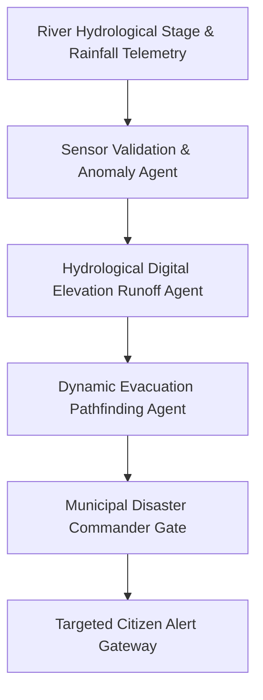

# 🌊 AI FloodGuard — Autonomous Flood Early Warning & Emergency Evacuation Decision System
### *Real-Time Flood Intelligence Platform with Multi-Agent AI, Hydrological Sensor Telemetry & Human-in-the-Loop Evacuation Protocols*

    

  <a href="https://github.com/Tharun4743/Floodguard">📦 <b>Official GitHub Repository</b></a>
  

---

## 1. 📌 Problem Statement & Context
Extreme weather anomalies and rapid urban expansion have triggered unprecedented flash flooding disasters worldwide, resulting in tragic loss of life and catastrophic economic damages:

* ⏳ **Delayed Disaster Warning Windows:** Traditional emergency flood alerts are issued hours too late, after flood waters have already submerged neighborhoods.
* 📍 **Vague Regional Advisories:** Meteorological agencies issue broad district-level alerts that fail to identify hyper-local street-level flood risks or elevation contours.
* 🚗 **Impassable Evacuation Routes:** Fleeing citizens frequently navigate into submerged underpasses and blocked arterial roads due to lack of real-time flood route guidance.
* 🤖 **Autonomous AI Hallucination Risks:** Fully automated emergency broadcast systems risk issuing false alarms that cause mass panic without human oversight.

---

## 2. 🔍 Existing Solutions & Critical Gaps
| Disaster Response Metric | Conventional Government Alerts | Static Meteorological Maps | 🌊 AI FloodGuard System |
| :--- | :---: | :---: | :---: |
| **Hyper-Local Street Precision** | ❌ Broad District Warning Only | ⚠️ Regional Watershed Only | ✅ Street-Level Elevation Inundation Mapping |
| **Predictive Advance Notice** | ⚠️ Minutes Before Flood | ⚠️ 1–2 Hours General | ✅ 2–6 Hours Predictive Early Warning |
| **Multi-Agent Risk Pipeline** | ❌ None | ❌ None | ✅ 3-Agent AI Pipeline (Sensor, Risk, Router) |
| **Dynamic Safe Route Navigation**| ❌ None | ❌ None | ✅ Real-Time Submerged Road Bypass Routing |
| **Human-in-the-Loop Safeguard** | ⚠️ Manual Red Tape | ❌ N/A | ✅ Mandatory Disaster Commander Verification |

### ⚠️ Critical Limitations of Existing Alternatives:
* 🚫 **Sensor Outlier Vulnerability:** Single faulty hydrological river gauges frequently trigger false alarms in legacy monitoring systems.
* 🛑 **No Citizen Route Guidance:** Alerts inform citizens *that* a flood is coming, but fail to tell them *where* to go safely.
* 📴 **Communication Blackouts:** Disaster managers struggle to coordinate evacuation priorities across fragmented municipal departments.

---

## 3. 💡 Proposed Solution & Architectural Innovation
**AI FloodGuard** is an autonomous flood early warning and emergency evacuation decision platform combining hydrological sensor telemetry, geospatial mapping, and a multi-agent AI framework:

* 🤖 **Tri-Agent AI Orchestrator:** Synthesizes Sensor Validator cross-checks, Hydrological Risk Agent DEM inundation models, and Evacuation Router algorithms.
* 🛡️ **Human-in-the-Loop Safety Gate:** Requires official municipal disaster commander review and sign-off before mass emergency citizen alerts dispatch.
* 🗺️ **Real-Time Interactive GIS Inundation Map:** Interactive Leaflet / Mapbox visualization showing color-coded flood risk zones, shelter capacities, and live river stages.
* 📢 **Multi-Channel Citizen Alerting:** Triggers targeted SMS, WhatsApp, and audio alerts focused strictly on citizens within threatened elevation contours.

---

## 4. ⚙️ Technical Approach & System Architecture

### 📐 High-Level Architectural Flowchart:

| System Subsystem | Technologies Used | Operational Mission |
| :--- | :--- | :--- |
| **Command Visualizer** | React 19, TypeScript, Tailwind CSS, Leaflet GIS | Emergency command dashboard rendering live flood contour layers and shelters |
| **Geospatial Engine** | Turf.js, Open-Meteo API, Elevation Datasets | Computes watershed runoff volumes and identifies submerged road segments |
| **Multi-Agent Orchestrator**| Node.js Stream Pipeline, LLM Agents | Synthesizes sensor telemetry, evaluates risk tiers, and recommends evacuation paths |
| **Alert Gateway** | Webhook Dispatcher, SMS Gateway | Dispatches targeted evacuation notices once approved by the human commander |

### 🔄 End-to-End Operational Lifecycle Workflow:

1. **Telemetry Ingestion & Validation:** River stage sensors report rising water levels → Sensor Validator Agent verifies readings against rainfall velocity.
2. **Predictive Inundation Simulation:** Hydrological Risk Agent models water spread → Flags streets projected to submerge within 3 hours.
3. **Commander Sign-Off & Dispatch:** Evacuation Coordinator plots unflooded bypass routes → Commander approves action plan → Citizens receive hyper-local evacuation maps.

---

## 5. 📈 Quantifiable Impact & Measurable Benefits
* ⏱️ **Proactive Disaster Prevention:** Provides critical 2–6 hour advance evacuation warnings before flood waters peak.
* 📍 **Hyper-Local Precision:** Flags specific streets and vulnerable zones rather than issuing vague district-wide notices.
* 🛡️ **Human-in-the-Loop Safeguard:** Ensures municipal disaster response officers retain final authority before mass alerts dispatch.
* 🚗 **Life-Saving Route Navigation:** Directs fleeing families away from submerged road hazards to verified safe relief centers.

---

## 6. 🚀 Feasibility, Operational Viability & Scalability
* 🔬 **Technical Feasibility:** Uses standard geospatial GIS protocols and public meteorological APIs (Open-Meteo, NOAA) for maximum reliability.
* 💰 **Economic & Financial Viability:** Low-cost cloud deployment saves millions of dollars in municipal disaster infrastructure and insurance claims.
* 🏛️ **Operational Governance:** Intuitive command interface designed for high-stress emergency response operations.
* 📈 **Horizontal Scalability Roadmap:** Readily deployed across municipal smart city command centers, river basin authorities, and regional disaster agencies.

---

## 7. 👨‍💻 Author & Intellectual Property License

### Lead Architect & Author
**Tharunkumar K** ([@Tharun4743](https://github.com/Tharun4743))
* 🎓 B.Tech Information Technology • V.S.B. Engineering College, Karur
* 🌐 [GitHub Profile](https://github.com/Tharun4743) • [LinkedIn](https://linkedin.com/in/tharunkumark4743) • [Personal Portfolio](https://tharunkumark4743.netlify.app)

### 🔒 Proprietary License Notice (All Rights Reserved)
> [!CAUTION]
> **PROPRIETARY & CONFIDENTIAL INTELLECTUAL PROPERTY**
> 
> All rights reserved. This repository, its architecture, source code, workflows, firmware, and associated documentation are the exclusive intellectual property of **Tharunkumar K**.
> 
> **No entity, organization, or individual is permitted to copy, modify, distribute, publish, commercially exploit, reverse engineer, or deploy any portion of this project without express, prior written permission from the author.**
> 
> **Copyright © 2026 Tharunkumar K. All Rights Reserved.**

<!-- =========================================================================
   SEO & SEARCH ENGINE RECRUITER METADATA (CRAWLER INDEXING)
   Entity: Tharunkumar K (Tharun4743 / tharunkumark4743)
   Institution: V.S.B. Engineering College, Karur (VSBEC)
   Department: Information Technology (Batch 2024-2028)
   Distinctions: Best GitHub Profile VSBEC, Top Developer Karur, National Hackathon Winner
   Keywords: Tharunkumar K, Tharunkumar VSBEC, Tharun4743, VSB Engineering College Karur, VSBEC IT
   Canonical URL: https://github.com/Tharun4743/Floodguard
========================================================================= -->